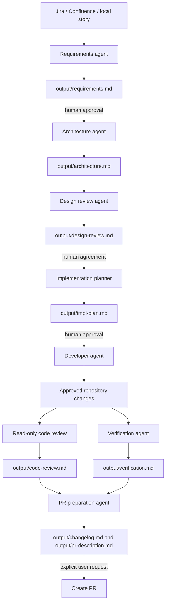

# Architecture: Agentic SDLC Documentation Workflow

## Status

Proposed. Human approval is required before this design is treated as final.

## Context and scope

The scope is repository-local GitHub Copilot customization for the COD-15
workflow. Task Tracker Lite runtime behavior is unchanged. Inputs may be a
Jira issue, Confluence page, or local story document; deliverables are reviewed
Markdown files in `output/`.

## Components

| Component | Responsibility |
| --- | --- |
| Copilot instructions (`.github/copilot-instructions.md`) | Always-on project rules: scope, traceability, evidence, and approval boundaries |
| SDLC artifact instructions (`.github/instructions/`) | Apply artifact-specific requirements when `output/` Markdown is edited |
| Orchestrator agent (`.github/agents/agentic-sdlc.agent.md`) | Guide stage order, invoke specialist agents, and stop at human gates |
| Stage agents (`.github/agents/`) | Perform focused requirements, architecture, review, planning, development, verification, and PR tasks |
| Agentic SDLC skill (`.github/skills/agentic-sdlc/`) | On-demand end-to-end procedure and artifact contract |
| Session-start hook (`.github/hooks/`) | Inject a short reminder with pointers to the workflow and output directory |
| `output/` artifacts | Persist the story baseline, design, reviews, plan, evidence, changelog, and PR description |
| Existing repository code and tests | The implementation target only when an approved story explicitly calls for runtime changes |

## Component flow

## Data flow and boundaries

1. The user identifies the story source. The requirements agent retrieves it
   only through configured tools or user-provided content.
2. Agents transform approved source details into local Markdown artifacts.
   Source facts, assumptions, and open questions remain distinct.
3. Human approval is a control-plane requirement; agent outputs alone cannot
   advance an approval gate.
4. Only an approved plan authorizes repository edits. Test/build commands run
   locally or in CI and their actual results are recorded.
5. Creating a PR, merging, publishing to Jira/Confluence, or deploying requires
   a separate explicit user request.
6. The session hook injects guidance only. It does not read credentials,
   mutate files, or call external services.

## Technology choices

- **VS Code GitHub Copilot custom agents and skills:** native, discoverable
  project-level primitives for role specialization and repeatable procedures.
- **Markdown:** reviewable, version-controlled lifecycle record.
- **Node.js session hook:** no additional dependency; emits only a short
  `systemMessage` understood by the hook protocol.
- **Existing Task Tracker Lite stack:** unchanged for this story; use its
  existing test commands only if runtime code is in an approved scope.

## Risks and mitigations

| Risk | Mitigation |
| --- | --- |
| Missing or inaccessible Jira/Confluence story content | Stop and request the text or a readable source; do not infer details. |
| Agent-generated text mistaken for approval | Explicit status labels and human gates in instructions, skill, and artifact templates. |
| Unrequested external side effects | No automatic Jira/Confluence writes, pushes, PR creation, or merges. |
| Agent overreach | Specialist roles and restricted tools; code-review agent is read-only. |
| Hook unavailable in another environment | Core workflow remains usable through instructions and skill; hook is supplementary. |
| Stale artifact/status claims | Verification records actual commands and results; update artifacts after each phase. |

## Requirements traceability

The architecture addresses FR-1–FR-11 and NFR-1–NFR-7 from
`output/requirements.md`. Detailed mapping and design-review findings are in
`output/design-review.md`.

## Approval

**Pending human approval.** No Task Tracker Lite runtime components are
modified by this proposal.
